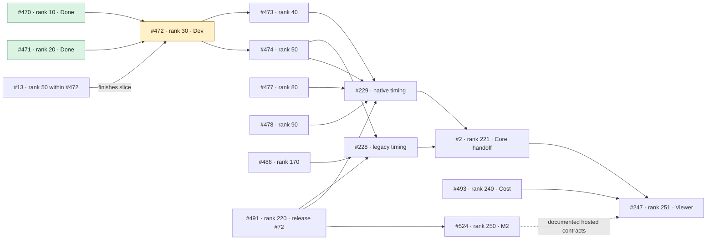

# Product delivery dependencies and rank correction

Project #24, read back at `2026-11-27T14:41:12.161Z`. Solid arrows show delivery order through
verified native dependencies or the owning slice. The dashed arrow shows
the hosted Viewer contract in the accepted plan. Green means Done and amber
means work is in progress. The chart focuses on the corrected paths.

| Consumer | Native story prerequisite | Owning epic | Epic rank |
| --- | --- | --- | ---: |
| #229 | #28 | #473 | 40 |
| #228 and #229 | #23 | #474 | 50 |
| #229 | #34 | #477 | 80 |
| #229 | #36 | #478 | 90 |
| #228 | #53, #54, #55, #56 | #486 | 170 |
| #228 and #229 | #72 | #491 | 220 |
| #247 | #2 | #2 | 221 |
| #259 | #230 | #493 | 240 |

The rank of an epic must follow the ranks of the external epics required
by its children. The #2 minimum is 221. Its direct prerequisite #456
is Done. Its reviewed kickoff is retained, and the board is back at
Ready for Planning until all six predecessor epics deliver.

The native graph places #247 after #493 because #259 requires #230. The
[Viewer plan](../../002/247/plan/2026-11-11-247-m6-viewer-decomposition.md)
also requires M2's delivered hosted issue-link and field/readback
contracts for #258, #257 and #259. #524 owns those contracts at rank
250, so #247 is rank 251. Child-specific acceptance and hosting
authorization still apply. #247 remains in Backlog.

The [structured readback](2026-11-27-dependency-rank-correction.json) covers 29 direct epics and
134 children under #1. After the correction every native same-parent
dependency and every cross-epic dependency derived from those issues
points from an earlier rank to a later one. Native issue relationships
remain intact. The displayed child ranks are local to their owning epic.
