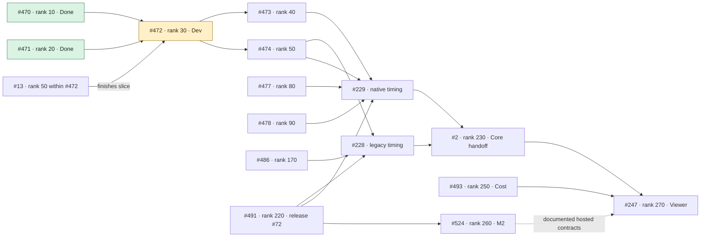

# Product backlog ranks and dependencies

Project #24 read back at `2026-11-27T14:49:29.502Z`. The map shows all 29 direct child
epics of #1. Each card shows its issue number and rank. Green marks Done
and amber marks work in progress. Solid arrows point from prerequisite
to dependent. The dashed arrow shows the documented M2 Viewer contract.

The graph preserves every native epic-level dependency as a path.
The table lists all 140 direct epic relationships, including dependencies
inherited from child stories. Prerequisites outside #1 are excluded from
this view.

```mermaid
flowchart LR
  E470["#470 · 10<br/>Records and reducers<br/>Done"]
  E471["#471 · 20<br/>Legacy rules<br/>Done"]
  E472["#472 · 30<br/>Trusted Git store<br/>Dev"]
  E473["#473 · 40<br/>Extension contracts"]
  E474["#474 · 50<br/>Store readback"]
  E475["#475 · 60<br/>Install and worktrees"]
  E476["#476 · 70<br/>Intake and numbering"]
  E477["#477 · 80<br/>Design and plan evidence"]
  E478["#478 · 90<br/>Planning and pickup"]
  E479["#479 · 100<br/>Configured transitions"]
  E480["#480 · 110<br/>Attempt and test preparation"]
  E481["#481 · 120<br/>Managed verification"]
  E482["#482 · 130<br/>Review and delivery evidence"]
  E483["#483 · 140<br/>Durable actions"]
  E484["#484 · 150<br/>Lifecycle and recovery"]
  E485["#485 · 160<br/>Branch and draft management"]
  E486["#486 · 170<br/>Legacy cutover"]
  E487["#487 · 180<br/>Installed local lifecycle"]
  E488["#488 · 190<br/>Concurrency recovery"]
  E489["#489 · 200<br/>PR delivery decisions"]
  E490["#490 · 210<br/>Hosted delivery"]
  E491["#491 · 220<br/>Core release"]
  E2["#2 · 230<br/>Core handoff"]
  E492["#492 · 240<br/>TIA package"]
  E493["#493 · 250<br/>Agent Cost package"]
  E524["#524 · 260<br/>GitHub provider M2"]
  E247["#247 · 270<br/>Viewer M6"]
  E522["#522 · 280<br/>History import M7"]
  E523["#523 · 290<br/>Estimation rubric M8"]
  E470 --> E472
  E471 --> E472
  E472 --> E473
  E473 --> E474
  E474 --> E475
  E475 --> E476
  E475 --> E477
  E476 --> E478
  E477 --> E478
  E478 --> E479
  E479 --> E480
  E480 --> E481
  E481 --> E482
  E481 --> E492
  E482 --> E483
  E483 --> E484
  E484 --> E485
  E485 --> E486
  E485 --> E489
  E486 --> E487
  E487 --> E488
  E487 --> E490
  E487 --> E493
  E488 --> E491
  E489 --> E490
  E491 --> E2
  E491 --> E524
  E2 --> E247
  E2 --> E523
  E493 --> E247
  E524 --> E522
  E522 --> E523
  E524 -. hosted Viewer contracts .-> E247
  classDef done fill:#daf3e3,stroke:#38825a,color:#152720
  classDef active fill:#fff0c8,stroke:#9d710f,color:#342707
  class E470,E471 done
  class E472 active
```

## Epic ranks and direct prerequisites

| Rank | Epic | Status at readback | Native prerequisite epics |
| ---: | --- | --- | --- |
| 10 | [#470](https://github.com/kburson/aitm/issues/470) Records and reducers | Done | — |
| 20 | [#471](https://github.com/kburson/aitm/issues/471) Legacy rules | Done | — |
| 30 | [#472](https://github.com/kburson/aitm/issues/472) Trusted Git store | Dev | [#470](https://github.com/kburson/aitm/issues/470), [#471](https://github.com/kburson/aitm/issues/471) |
| 40 | [#473](https://github.com/kburson/aitm/issues/473) Extension contracts | Ready for Planning | [#470](https://github.com/kburson/aitm/issues/470), [#472](https://github.com/kburson/aitm/issues/472) |
| 50 | [#474](https://github.com/kburson/aitm/issues/474) Store readback | Ready for Planning | [#470](https://github.com/kburson/aitm/issues/470), [#472](https://github.com/kburson/aitm/issues/472), [#473](https://github.com/kburson/aitm/issues/473) |
| 60 | [#475](https://github.com/kburson/aitm/issues/475) Install and worktrees | Ready for Planning | [#472](https://github.com/kburson/aitm/issues/472), [#473](https://github.com/kburson/aitm/issues/473), [#474](https://github.com/kburson/aitm/issues/474) |
| 70 | [#476](https://github.com/kburson/aitm/issues/476) Intake and numbering | Ready for Planning | [#473](https://github.com/kburson/aitm/issues/473), [#474](https://github.com/kburson/aitm/issues/474), [#475](https://github.com/kburson/aitm/issues/475) |
| 80 | [#477](https://github.com/kburson/aitm/issues/477) Design and plan evidence | Ready for Planning | [#470](https://github.com/kburson/aitm/issues/470), [#473](https://github.com/kburson/aitm/issues/473), [#474](https://github.com/kburson/aitm/issues/474), [#475](https://github.com/kburson/aitm/issues/475) |
| 90 | [#478](https://github.com/kburson/aitm/issues/478) Planning and pickup | Ready for Planning | [#470](https://github.com/kburson/aitm/issues/470), [#472](https://github.com/kburson/aitm/issues/472), [#473](https://github.com/kburson/aitm/issues/473), [#475](https://github.com/kburson/aitm/issues/475), [#476](https://github.com/kburson/aitm/issues/476), [#477](https://github.com/kburson/aitm/issues/477) |
| 100 | [#479](https://github.com/kburson/aitm/issues/479) Configured transitions | Ready for Planning | [#471](https://github.com/kburson/aitm/issues/471), [#473](https://github.com/kburson/aitm/issues/473), [#474](https://github.com/kburson/aitm/issues/474), [#475](https://github.com/kburson/aitm/issues/475), [#476](https://github.com/kburson/aitm/issues/476), [#477](https://github.com/kburson/aitm/issues/477), [#478](https://github.com/kburson/aitm/issues/478) |
| 110 | [#480](https://github.com/kburson/aitm/issues/480) Attempt and test preparation | Ready for Planning | [#472](https://github.com/kburson/aitm/issues/472), [#473](https://github.com/kburson/aitm/issues/473), [#474](https://github.com/kburson/aitm/issues/474), [#475](https://github.com/kburson/aitm/issues/475), [#476](https://github.com/kburson/aitm/issues/476), [#478](https://github.com/kburson/aitm/issues/478), [#479](https://github.com/kburson/aitm/issues/479) |
| 120 | [#481](https://github.com/kburson/aitm/issues/481) Managed verification | Ready for Planning | [#473](https://github.com/kburson/aitm/issues/473), [#475](https://github.com/kburson/aitm/issues/475), [#480](https://github.com/kburson/aitm/issues/480) |
| 130 | [#482](https://github.com/kburson/aitm/issues/482) Review and delivery evidence | Ready for Planning | [#470](https://github.com/kburson/aitm/issues/470), [#472](https://github.com/kburson/aitm/issues/472), [#475](https://github.com/kburson/aitm/issues/475), [#477](https://github.com/kburson/aitm/issues/477), [#479](https://github.com/kburson/aitm/issues/479), [#480](https://github.com/kburson/aitm/issues/480), [#481](https://github.com/kburson/aitm/issues/481) |
| 140 | [#483](https://github.com/kburson/aitm/issues/483) Durable actions | Ready for Planning | [#470](https://github.com/kburson/aitm/issues/470), [#473](https://github.com/kburson/aitm/issues/473), [#474](https://github.com/kburson/aitm/issues/474), [#475](https://github.com/kburson/aitm/issues/475), [#476](https://github.com/kburson/aitm/issues/476), [#479](https://github.com/kburson/aitm/issues/479), [#480](https://github.com/kburson/aitm/issues/480), [#481](https://github.com/kburson/aitm/issues/481), [#482](https://github.com/kburson/aitm/issues/482) |
| 150 | [#484](https://github.com/kburson/aitm/issues/484) Lifecycle and recovery | Ready for Planning | [#471](https://github.com/kburson/aitm/issues/471), [#473](https://github.com/kburson/aitm/issues/473), [#474](https://github.com/kburson/aitm/issues/474), [#476](https://github.com/kburson/aitm/issues/476), [#478](https://github.com/kburson/aitm/issues/478), [#479](https://github.com/kburson/aitm/issues/479), [#480](https://github.com/kburson/aitm/issues/480), [#481](https://github.com/kburson/aitm/issues/481), [#482](https://github.com/kburson/aitm/issues/482), [#483](https://github.com/kburson/aitm/issues/483) |
| 160 | [#485](https://github.com/kburson/aitm/issues/485) Branch and draft management | Ready for Planning | [#473](https://github.com/kburson/aitm/issues/473), [#475](https://github.com/kburson/aitm/issues/475), [#476](https://github.com/kburson/aitm/issues/476), [#478](https://github.com/kburson/aitm/issues/478), [#479](https://github.com/kburson/aitm/issues/479), [#483](https://github.com/kburson/aitm/issues/483), [#484](https://github.com/kburson/aitm/issues/484) |
| 170 | [#486](https://github.com/kburson/aitm/issues/486) Legacy cutover | Ready for Planning | [#470](https://github.com/kburson/aitm/issues/470), [#472](https://github.com/kburson/aitm/issues/472), [#474](https://github.com/kburson/aitm/issues/474), [#475](https://github.com/kburson/aitm/issues/475), [#477](https://github.com/kburson/aitm/issues/477), [#478](https://github.com/kburson/aitm/issues/478), [#479](https://github.com/kburson/aitm/issues/479), [#484](https://github.com/kburson/aitm/issues/484), [#485](https://github.com/kburson/aitm/issues/485) |
| 180 | [#487](https://github.com/kburson/aitm/issues/487) Installed local lifecycle | Ready for Planning | [#473](https://github.com/kburson/aitm/issues/473), [#474](https://github.com/kburson/aitm/issues/474), [#475](https://github.com/kburson/aitm/issues/475), [#476](https://github.com/kburson/aitm/issues/476), [#477](https://github.com/kburson/aitm/issues/477), [#478](https://github.com/kburson/aitm/issues/478), [#479](https://github.com/kburson/aitm/issues/479), [#480](https://github.com/kburson/aitm/issues/480), [#481](https://github.com/kburson/aitm/issues/481), [#482](https://github.com/kburson/aitm/issues/482), [#483](https://github.com/kburson/aitm/issues/483), [#484](https://github.com/kburson/aitm/issues/484), [#486](https://github.com/kburson/aitm/issues/486) |
| 190 | [#488](https://github.com/kburson/aitm/issues/488) Concurrency recovery | Ready for Planning | [#475](https://github.com/kburson/aitm/issues/475), [#478](https://github.com/kburson/aitm/issues/478), [#479](https://github.com/kburson/aitm/issues/479), [#480](https://github.com/kburson/aitm/issues/480), [#481](https://github.com/kburson/aitm/issues/481), [#482](https://github.com/kburson/aitm/issues/482), [#483](https://github.com/kburson/aitm/issues/483), [#484](https://github.com/kburson/aitm/issues/484), [#487](https://github.com/kburson/aitm/issues/487) |
| 200 | [#489](https://github.com/kburson/aitm/issues/489) PR delivery decisions | Ready for Planning | [#471](https://github.com/kburson/aitm/issues/471), [#473](https://github.com/kburson/aitm/issues/473), [#481](https://github.com/kburson/aitm/issues/481), [#482](https://github.com/kburson/aitm/issues/482), [#484](https://github.com/kburson/aitm/issues/484), [#485](https://github.com/kburson/aitm/issues/485) |
| 210 | [#490](https://github.com/kburson/aitm/issues/490) Hosted delivery | Ready for Planning | [#473](https://github.com/kburson/aitm/issues/473), [#484](https://github.com/kburson/aitm/issues/484), [#485](https://github.com/kburson/aitm/issues/485), [#487](https://github.com/kburson/aitm/issues/487), [#489](https://github.com/kburson/aitm/issues/489) |
| 220 | [#491](https://github.com/kburson/aitm/issues/491) Core release | Ready for Planning | [#470](https://github.com/kburson/aitm/issues/470), [#474](https://github.com/kburson/aitm/issues/474), [#481](https://github.com/kburson/aitm/issues/481), [#483](https://github.com/kburson/aitm/issues/483), [#484](https://github.com/kburson/aitm/issues/484), [#486](https://github.com/kburson/aitm/issues/486), [#487](https://github.com/kburson/aitm/issues/487), [#488](https://github.com/kburson/aitm/issues/488) |
| 230 | [#2](https://github.com/kburson/aitm/issues/2) Core handoff | Ready for Planning | [#473](https://github.com/kburson/aitm/issues/473), [#474](https://github.com/kburson/aitm/issues/474), [#477](https://github.com/kburson/aitm/issues/477), [#478](https://github.com/kburson/aitm/issues/478), [#486](https://github.com/kburson/aitm/issues/486), [#491](https://github.com/kburson/aitm/issues/491) |
| 240 | [#492](https://github.com/kburson/aitm/issues/492) TIA package | Backlog | [#481](https://github.com/kburson/aitm/issues/481) |
| 250 | [#493](https://github.com/kburson/aitm/issues/493) Agent Cost package | Backlog | [#487](https://github.com/kburson/aitm/issues/487) |
| 260 | [#524](https://github.com/kburson/aitm/issues/524) GitHub provider M2 | Backlog | [#491](https://github.com/kburson/aitm/issues/491) |
| 270 | [#247](https://github.com/kburson/aitm/issues/247) Viewer M6 | Backlog | [#2](https://github.com/kburson/aitm/issues/2), [#493](https://github.com/kburson/aitm/issues/493) |
| 280 | [#522](https://github.com/kburson/aitm/issues/522) History import M7 | Backlog | [#491](https://github.com/kburson/aitm/issues/491), [#524](https://github.com/kburson/aitm/issues/524) |
| 290 | [#523](https://github.com/kburson/aitm/issues/523) Estimation rubric M8 | Backlog | [#487](https://github.com/kburson/aitm/issues/487), [#491](https://github.com/kburson/aitm/issues/491), [#2](https://github.com/kburson/aitm/issues/2), [#522](https://github.com/kburson/aitm/issues/522) |

## Core handoff and Viewer detail

See the [handoff prerequisite table](2026-11-27-dependency-rank-correction.md)
for the specific child stories and the [rank readback](2026-11-27-product-rank-scale.json)
for the full epic and child rank inventory. Child ranks are local to each epic.
