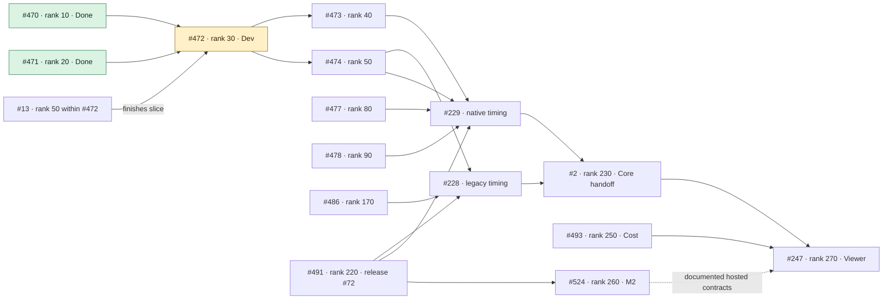

# Product backlog ranks

Project #24 read back at `2026-11-27T14:46:30.358Z`. Product epic ranks are spaced by 10 in
the corrected delivery order. Child ranks are scoped to their own epic.
Existing Viewer rank groups retain their shared ranks. The previously
unranked #525 is rank 10 within #524.

Green marks Done and amber marks work in progress. The dashed arrow shows
the documented hosted Viewer contract.

| Rank | Epic | Status at readback |
| ---: | --- | --- |
| 10 | [#470](https://github.com/kburson/aitm/issues/470) | Done |
| 20 | [#471](https://github.com/kburson/aitm/issues/471) | Done |
| 30 | [#472](https://github.com/kburson/aitm/issues/472) | Dev |
| 40 | [#473](https://github.com/kburson/aitm/issues/473) | Ready for Planning |
| 50 | [#474](https://github.com/kburson/aitm/issues/474) | Ready for Planning |
| 60 | [#475](https://github.com/kburson/aitm/issues/475) | Ready for Planning |
| 70 | [#476](https://github.com/kburson/aitm/issues/476) | Ready for Planning |
| 80 | [#477](https://github.com/kburson/aitm/issues/477) | Ready for Planning |
| 90 | [#478](https://github.com/kburson/aitm/issues/478) | Ready for Planning |
| 100 | [#479](https://github.com/kburson/aitm/issues/479) | Ready for Planning |
| 110 | [#480](https://github.com/kburson/aitm/issues/480) | Ready for Planning |
| 120 | [#481](https://github.com/kburson/aitm/issues/481) | Ready for Planning |
| 130 | [#482](https://github.com/kburson/aitm/issues/482) | Ready for Planning |
| 140 | [#483](https://github.com/kburson/aitm/issues/483) | Ready for Planning |
| 150 | [#484](https://github.com/kburson/aitm/issues/484) | Ready for Planning |
| 160 | [#485](https://github.com/kburson/aitm/issues/485) | Ready for Planning |
| 170 | [#486](https://github.com/kburson/aitm/issues/486) | Ready for Planning |
| 180 | [#487](https://github.com/kburson/aitm/issues/487) | Ready for Planning |
| 190 | [#488](https://github.com/kburson/aitm/issues/488) | Ready for Planning |
| 200 | [#489](https://github.com/kburson/aitm/issues/489) | Ready for Planning |
| 210 | [#490](https://github.com/kburson/aitm/issues/490) | Ready for Planning |
| 220 | [#491](https://github.com/kburson/aitm/issues/491) | Ready for Planning |
| 230 | [#2](https://github.com/kburson/aitm/issues/2) | Ready for Planning |
| 240 | [#492](https://github.com/kburson/aitm/issues/492) | Backlog |
| 250 | [#493](https://github.com/kburson/aitm/issues/493) | Backlog |
| 260 | [#524](https://github.com/kburson/aitm/issues/524) | Backlog |
| 270 | [#247](https://github.com/kburson/aitm/issues/247) | Backlog |
| 280 | [#522](https://github.com/kburson/aitm/issues/522) | Backlog |
| 290 | [#523](https://github.com/kburson/aitm/issues/523) | Backlog |

The readback covers all 29 product epics and 134 children under #1. Every
rank is a positive multiple of 10. Each native dependency in scope and
the documented M2-to-Viewer gate respects the new order. See the
[prerequisite table](2026-11-27-dependency-rank-correction.md) and the [structured readback](2026-11-27-product-rank-scale.json).
