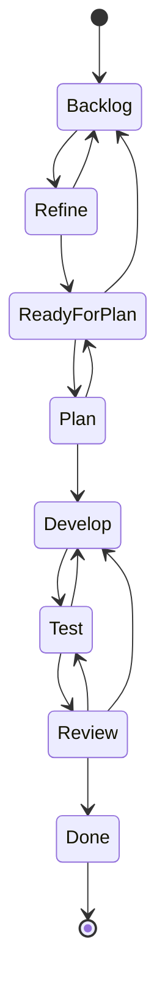

# AI Task Manager — SDLC State Machine Analysis

## Scope

Analysis of the existing [ai-task-manager GitHub repository](https://github.com/kburson/ai-task-manager), default branch `trunk`, returned tree SHA `c8b64b6b2d0e404cbae9a1d5eced7d94c36b4905`. The canonical lifecycle definitions, all eight state modules, executable transition policy, and state-machine architecture documentation were inspected. The repository was not modified and tests were not run.

For the Python rewrite, treat this as a **behavioral decomposition rather than a language migration**. Preserve the accumulated SDLC intelligence without necessarily preserving the implementation complexity. Separate state definitions and topology, entry and exit guards, resident actions, agent behavioral rules, cross-state policies and invariants, transition orchestration, evidence and recovery, and external integrations and persistence.

The existing state machine provides a good starting point, but does not contain the entirety of the SDLC enforcement logic.

## 1. Existing SDLC state machine



| # | State | Primary responsibility |
|---:|---|---|
| 1 | Backlog | Capture and queue work |
| 2 | Refine | Define requirements, scope and acceptance criteria |
| 3 | Ready for Planning | Park refined work until eligible for development planning |
| 4 | Plan | Establish and approve the implementation approach |
| 5 | Develop | Implement and verify the solution |
| 6 | Test | Validate implementation and CI results |
| 7 | Review | Independently assess the delivered solution |
| 8 | Done | Terminal completion state |

Sources: [Canonical state definitions](https://github.com/kburson/ai-task-manager/blob/trunk/scripts/task-tracker/lib/lifecycle-policy/states.mjs), [Executable transition policy](https://github.com/kburson/ai-task-manager/blob/trunk/scripts/task-tracker/lib/lifecycle-policy/executable-transitions.mjs).

### 1.1 Existing state container

Each state exports an immutable definition:

```javascript
{
    id: 'plan',
    entryGuards: [...],
    residentActions: [...],
    exitGuards: [...]
}
```

The state factory constructs an ordered array and an ID map from which it derives previous, next and permitted backward transitions. Technically, it is not a traditional linked list with mutable node pointers, but provides equivalent bidirectional navigation with additional explicit transition rules.

The existing implementation treats `onEnter` as an orchestration event, not a separate configurable list. After a transition succeeds, `onEnter` invokes the resident actions of the newly entered state.

Source: [State machine architecture](https://github.com/kburson/ai-task-manager/blob/trunk/docs/architecture/state-machine.md).

## 2. State-by-state guard and action mapping

The inventory preserves the ordering declared in the state module arrays. Descriptions are normalized into business-oriented rule names and are a first-pass interpretation, not an exhaustive analysis of every conditional branch.

### 2.1 Backlog

**Purpose:** Capture work without prematurely committing development resources.

| Phase | Order | Guard or action |
|---|---:|---|
| Entry | 1 | State chain contiguity |
| Resident | — | None registered |
| Exit | 1 | Unresolved discussion directive check |

An unresolved `{discuss}` directive blocks promotion out of Backlog, including in full-auto mode. Open dependencies do not prevent refinement; they become an admission constraint later.

Next: Refine. [Source](https://github.com/kburson/ai-task-manager/blob/trunk/scripts/task-tracker/states/backlog.mjs).

### 2.2 Refine

**Purpose:** Transform a loosely defined request into actionable development work.

| Phase | Order | Guard or action |
|---|---:|---|
| Entry | 1 | State chain contiguity |
| Entry | 2 | Parent epic state eligibility |
| Resident | — | None registered |
| Exit | 1 | Refinement completion marker |
| Exit | 2 | Removal of unresolved stub placeholders |
| Exit | 3 | Refinement snapshot verification |
| Exit | 4 | Required issue body fields |
| Exit | 5 | Required project board fields |

Although no resident actions are registered, considerable agent-driven work takes place here, including scope definition, acceptance criteria and metadata preparation. The current `residentActions` array does not describe everything the agent is expected to do.

Next: Ready for Planning. Backward: Backlog. [Source](https://github.com/kburson/ai-task-manager/blob/trunk/scripts/task-tracker/states/refine.mjs).

### 2.3 Ready for Planning

**Purpose:** Separate preparation of work from commitment of development resources.

| Phase | Order | Guard or action |
|---|---:|---|
| Entry | 1 | State chain contiguity |
| Resident | — | None registered |
| Exit | 1 | Blocking dependency check |
| Exit | 2 | Epic children readiness |
| Exit | 3 | Work-in-progress budget |
| Exit | 4 | Parent epic state eligibility |
| Exit | 5 | Child cannot advance ahead of its epic |

This is an **admission-control state** rather than an active work state. An issue can be fully refined and remain parked here until dependencies, resource constraints and parent-child relationships permit planning.

Next: Plan. Backward: Backlog. [Source](https://github.com/kburson/ai-task-manager/blob/trunk/scripts/task-tracker/states/ready-for-plan.mjs).

### 2.4 Plan

**Purpose:** Establish the approved technical approach for implementation.

| Phase | Order | Guard or action |
|---|---:|---|
| Entry | 1 | State chain contiguity |
| Resident | — | None registered |
| Exit | 1 | Blocking dependency check |
| Exit | 2 | Work-in-progress budget |
| Exit | 3 | Plan approval |
| Exit | 4 | Story approval binding |
| Exit | 5 | Planned estimate |
| Exit | 6 | Deep-dive completion |
| Exit | 7 | Required plan metadata |
| Exit | 8 | Verification criteria presence |
| Exit | 9 | Ownership verification |
| Exit | 10 | Decomposition completion |
| Exit | 11 | Epic children eligibility |
| Exit | 12 | Child cannot advance ahead of its epic |

Plan has the most extensive registered exit contract. Human and policy-based authorization, documentation completeness, estimation, technical verification planning, resource allocation, work decomposition and hierarchical task coordination are potential independent policy modules in Python.

Next: Develop. Backward: Ready for Planning. [Source](https://github.com/kburson/ai-task-manager/blob/trunk/scripts/task-tracker/states/plan.mjs).

### 2.5 Develop

**Purpose:** Implement the approved plan and produce verifiable development evidence.

| Phase | Order | Guard or action |
|---|---:|---|
| Entry | 1 | State chain contiguity |
| Resident | 1 | Development verification action |
| Exit | 1 | Blocking dependency check |
| Exit | 2 | Code-complete marker |
| Exit | 3 | Development verification receipt |
| Exit | 4 | Commit trail and HEAD verification |
| Exit | 5 | Epic children completion |
| Exit | 6 | Child cannot advance ahead of its epic |

The resident action produces verification evidence. The exit guard consumes the final receipt and checks its applicability to the exact Git HEAD. That separation is worth preserving.

Next: Test. Backward: None under ordinary executable transition policy. [Source](https://github.com/kburson/ai-task-manager/blob/trunk/scripts/task-tracker/states/develop.mjs).

### 2.6 Test

**Purpose:** Establish that the implementation satisfies its delivery and verification requirements.

| Phase | Order | Guard or action |
|---|---:|---|
| Entry | 1 | State chain contiguity |
| Entry | 2 | Test issue body gates |
| Resident | 1 | Pull request and quick CI action |
| Exit | 1 | Blocking dependency check |
| Exit | 2 | Definition of Done verification |
| Exit | 3 | Pre-close completeness |
| Exit | 4 | Reviewed scope verification |
| Exit | 5 | Child cannot advance ahead of its epic |

Test becomes current before its CI-related resident work completes. Waiting for CI does not require keeping the task in Develop or repeatedly crossing the boundary.

Next: Review. Backward: Develop. [Source](https://github.com/kburson/ai-task-manager/blob/trunk/scripts/task-tracker/states/test.mjs).

### 2.7 Review

**Purpose:** Perform independent validation and authorize final completion.

| Phase | Order | Guard or action |
|---|---:|---|
| Entry | 1 | State chain contiguity |
| Entry | 2 | Review issue body gates |
| Resident | 1 | Review agent validation |
| Exit | 1 | Blocking dependency check |
| Exit | 2 | Review approval |
| Exit | 3 | Epic children completion |
| Exit | 4 | Epic child disposition verification |
| Exit | 5 | Final close gates |
| Exit | 6 | Child cannot advance ahead of its epic |

The documented final close gates include state-chain integrity, commits on trunk, issue-dirty checks and required markers. The child disposition guard distinguishes children successfully completed from children closed without implementation while carrying outstanding acceptance criteria.

Next: Done. Backward: Test, Develop. [Source](https://github.com/kburson/ai-task-manager/blob/trunk/scripts/task-tracker/states/review.mjs).

### 2.8 Done

**Purpose:** Represent terminal completion.

| Phase | Order | Guard or action |
|---|---:|---|
| Entry | 1 | Done issue body gates |
| Resident | — | None registered |
| Exit | — | None registered |

There are no ordinary executable transitions out of Done. [Source](https://github.com/kburson/ai-task-manager/blob/trunk/scripts/task-tracker/states/done.mjs).

## 3. Consolidated state matrix

| State | Entry guards | Resident actions | Exit guards | Total registrations |
|---|---:|---:|---:|---:|
| Backlog | 1 | 0 | 1 | 2 |
| Refine | 2 | 0 | 5 | 7 |
| Ready for Planning | 1 | 0 | 5 | 6 |
| Plan | 1 | 0 | 12 | 13 |
| Develop | 1 | 1 | 6 | 8 |
| Test | 2 | 1 | 5 | 8 |
| Review | 2 | 1 | 6 | 9 |
| Done | 1 | 0 | 0 | 1 |
| **Total** | **11** | **3** | **40** | **54** |

These are registrations, not unique guard implementations. The disproportionate number of guards compared with actions indicates that the definitions primarily describe **what prevents progress**, rather than comprehensively describing **what must be accomplished**.

## 4. Cross-state policy mapping

| Policy family | Current application |
|---|---|
| State chain integrity | Entry into Backlog through Review; additional close checks |
| Dependency management | Exit from Ready for Planning, Plan, Develop, Test and Review |
| WIP management | Exit from Ready for Planning and Plan |
| Parent-child synchronization | Refine through Review, with state-specific conditions |
| Issue body completeness | Refine exit and Test, Review and Done entry |
| Human authorization | Discussion, plan approval and review approval |
| Evidence integrity | Refinement, development, testing and closure |
| Source control integrity | Develop exit and final closure |
| Ownership | Plan exit |
| Estimation | Plan exit |
| Work decomposition | Plan exit |
| Independent validation | Review resident action |

Additional enforcement modules outside the state definitions:

| Enforcement area | Existing module examples |
|---|---|
| Agent activity restrictions | `activity-guard.mjs` |
| Agent invocation restrictions | `agent-guard.mjs` |
| Shell command restrictions | `bash-guard.mjs` |
| GitHub mutation restrictions | `gh-edit-guard.mjs` |
| Project board protection | `gh-project-guard.mjs` |
| Worktree management | `worktree-binding-guard.mjs` |
| State-specific command eligibility | `verb-home-state-guard.mjs` |
| Evidence fabrication protection | `evidence-v2/entry-guard.mjs` |
| Blast radius control | `blast-radius-guard.mjs` |
| Workflow exceptions | `workflow-policy/` |
| Session lifecycle | `hooks/` |

These modules were identified in the repository tree. Their complete implementation semantics have not yet been inventoried. Changing only the state machine would leave a considerable portion of the existing enforcement architecture unaccounted for.

## 5. Existing transition orchestration

The architecture documents a stateless cursor reconstructed on each invocation.

| Operation | Behavior |
|---|---|
| `advance-forward` | Complete resident actions and attempt one forward transition |
| `advance-reverse` | Perform a permitted backward transition |
| `bypass` | Carry explicit force or supersede audit intent |
| `actions-only` | Verify or resume resident actions without moving state |

```text
Load task snapshot
        │
        ▼
Reconcile durable state evidence
        │
        ▼
Verify current resident actions
        │
        ├── Incomplete → Execute or resume action
        ├── Waiting ────→ Remain in current state
        ├── Failed ─────→ Remain in current state
        ▼
Acquire transition lock
        ▼
Reload current authoritative state
        ▼
Evaluate source exit guards
        ▼
Evaluate destination entry guards
        ▼
Commit state transition and evidence
        ▼
Reload destination state
        ▼
Verify or execute destination resident actions
```

This addresses interrupted sessions, context compaction, duplicate actions, external provider waits, agent handoffs, unauthorized transitions, and durable evidence independent of agent memory. The Python rewrite should preserve these properties even with a simpler implementation.

Source: [Stateless cursor and repository authority](https://github.com/kburson/ai-task-manager/blob/trunk/docs/architecture/state-machine.md).

## 6. Preliminary direction for the Python architecture

Investigate a **configuration-driven SDLC execution engine**, rather than another task manager with a hardcoded SDLC state machine. AI Task Manager would supply a default workflow, but the engine would not inherently know what Backlog, Refine, Develop or Review mean.

### 6.1 Separation of responsibilities

```text
AI Task Manager Interface — CLI / MCP / Agent API
                         │
SDLC Configuration — States · Transitions · Rules · Policies
                         │
Workflow Engine — Evaluate · Execute · Verify · Transition
                         │
Capability Registry — Checks · Guards · Actions · Evidence
                         │
Provider Adapters — GitHub · Git · CI · Agents · Storage
```

Projects could customize their SDLC without modifying the Python engine.

### 6.2 Illustrative state configuration

YAML is illustrative only; no configuration format has been selected.

```yaml
states:
  - id: develop
    name: Development
    previous: plan
    next: test
    on_enter:
      - guard: state_chain_integrity
    actions:
      - directive: implement_approved_plan
      - action: verify_development
        produces:
          - development_receipt
    on_exit:
      - guard: no_open_dependencies
      - guard: code_complete
      - guard: development_receipt_valid
      - guard: commit_trail_valid
      - guard: epic_children_complete
      - guard: child_cannot_lead_epic
```

Instead of importing implementation functions, a state references capabilities by name, resolved through a registry. The state definition becomes data rather than application code.

### 6.3 Checks, guards, actions, directives and policies

| Type | Responsibility | Example |
|---|---|---|
| Check | Establish a fact | Does a PR exist? |
| Guard | Decide whether an operation is permitted | Is the PR approved? |
| Action | Perform deterministic work | Create a pull request |
| Directive | Instruct an agent to perform cognitive work | Design an implementation plan |
| Policy | Define rules across states or operations | A child cannot advance ahead of its epic |
| Evidence | Record a verifiable fact or completed action | CI passed against commit SHA |
| Event | Represent something that occurred | Review completed |

```yaml
- check: pull_request_status
  register_as: pr_status
- guard: require
  condition: pr_status.approved == true
- action: merge_pull_request
- check: commit_on_trunk
```

The check acquires information, the guard interprets it, the action performs work, and the final check verifies the result. This could make the rule system easier to compose, explain and test.

## 7. Agent directives as state configuration

The existing JavaScript implementation has only three registered resident actions, despite considerable agent work throughout Refine, Plan and Develop. The distinction between procedural and agentic execution deserves first-class representation.

```yaml
- id: refine
  actions:
    - directive: analyze_user_requirements
      produces:
        - requirements
    - directive: define_acceptance_criteria
      produces:
        - acceptance_criteria
    - directive: identify_dependencies
      produces:
        - dependency_list
    - action: validate_issue_structure
    - action: publish_refinement_snapshot
```

The workflow engine communicates the directive, identifies expected deliverables and verifies evidence rather than performing reasoning itself. This is consistent with the previous architectural direction of minimal skill prose and just-in-time instructions through the orchestrator's help and execution interfaces.

## 8. Configurable workflow profiles

| State | Full SDLC | Lightweight SDLC | Documentation | Research spike |
|---|:---:|:---:|:---:|:---:|
| Backlog | ✓ | ✓ | ✓ | ✓ |
| Refine | ✓ | ✓ | ✓ | ✓ |
| Ready for Planning | ✓ | — | — | — |
| Plan | ✓ | ✓ | — | — |
| Develop | ✓ | ✓ | — | — |
| Research | — | — | — | ✓ |
| Author | — | — | ✓ | — |
| Test | ✓ | ✓ | — | — |
| Review | ✓ | ✓ | ✓ | ✓ |
| Done | ✓ | ✓ | ✓ | ✓ |

Projects could configure applicable policies:

```yaml
policies:
  human_plan_approval:
    enabled: true
  independent_peer_review:
    enabled: true
  work_in_progress:
    enabled: true
    maximum: 3
  epic_child_contiguity:
    enabled: true
  source_control:
    enabled: true
  verification:
    require_exact_commit: true
```

These are proposed capabilities, not claims about the current implementation.

## 9. What to preserve versus reconsider

| Existing architectural concept | Python rewrite direction |
|---|---|
| Immutable state definitions | Preserve |
| Ordered lifecycle stages | Preserve, make configurable |
| Explicit reverse transitions | Preserve, make configurable |
| Entry and exit guard ordering | Preserve |
| Stateless cursor | Preserve the recovery semantics |
| Verify-before-execute actions | Preserve |
| Durable action evidence | Preserve |
| Fail-closed enforcement | Preserve |
| Exact Git HEAD verification | Preserve as a configurable policy |
| Parent-child lifecycle synchronization | Extract into reusable policy |
| Human approvals | Extract into reusable authorization policy |
| Hardcoded eight-state topology | Replace |
| JavaScript-specific guard imports | Replace with capability registry |
| GitHub-specific state authority | Abstract behind a provider |
| Issue body markers | Abstract behind an evidence store |
| Distributed agent instructions | Consolidate into configurable directives |
| CLI-specific workflow logic | Move into the shared execution engine |
| Runtime-specific hooks | Abstract behind agent adapters |

## 10. Remaining analysis of the legacy project

This is the **first-pass canonical state inventory**, not the complete behavioral specification.

| Analysis area | Status |
|---|---|
| Canonical states | Complete |
| Permitted forward transitions | Complete |
| Permitted reverse transitions | Complete |
| Registered entry guard mapping | Complete |
| Registered resident action mapping | Complete |
| Registered exit guard mapping | Complete |
| Internal guard conditions and exceptions | Pending |
| Resident action implementation details | Pending |
| Agent behavioral rules and directives | Pending |
| State-specific permitted and prohibited operations | Pending |
| Native agent hook enforcement | Pending |
| Full-auto behavior and exceptions | Pending |
| Epic, story, task and spike differences | Pending |
| Evidence schema and dependencies | Pending |
| Error handling and recovery behavior | Pending |
| Test-based verification of documented behavior | Pending |

### Recommended next step

Before choosing Python classes, libraries, persistence mechanisms or configuration formats, build a **Legacy SDLC Rule Catalog**. Each unique rule would receive a normalized definition:

```yaml
id:
name:
description:
category:
applicable_states:
execution_phase:
trigger:
preconditions:
inputs:
evaluation_logic:
required_evidence:
produced_evidence:
on_success:
on_failure:
exceptions:
source_files:
source_tests:
```

The catalog would become behavioral requirements for the rewrite, independent of JavaScript, Python, GitHub, Codex or Claude. It would expose redundant guards, unnecessarily coupled rules, duplicated enforcement, rules belonging in global policies and rules that should be optional for projects.

Finish that behavioral decomposition before committing to the new architecture. The goal is to retain the accumulated agentic SDLC knowledge while making the execution engine substantially simpler and more configurable.
